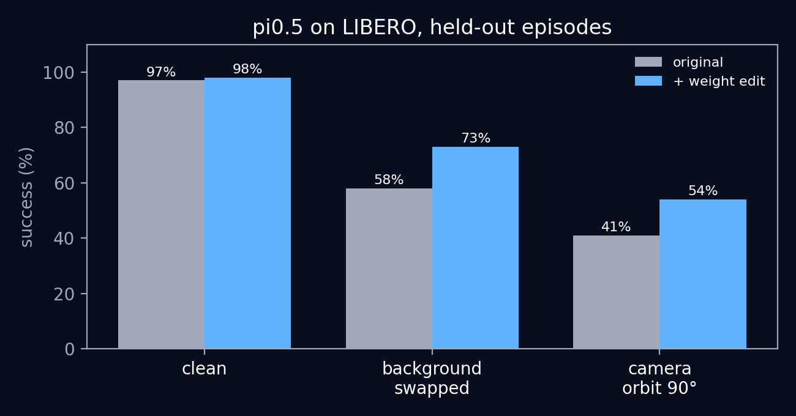
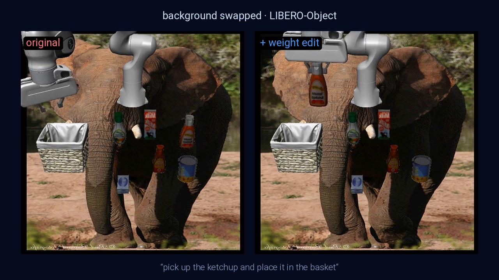
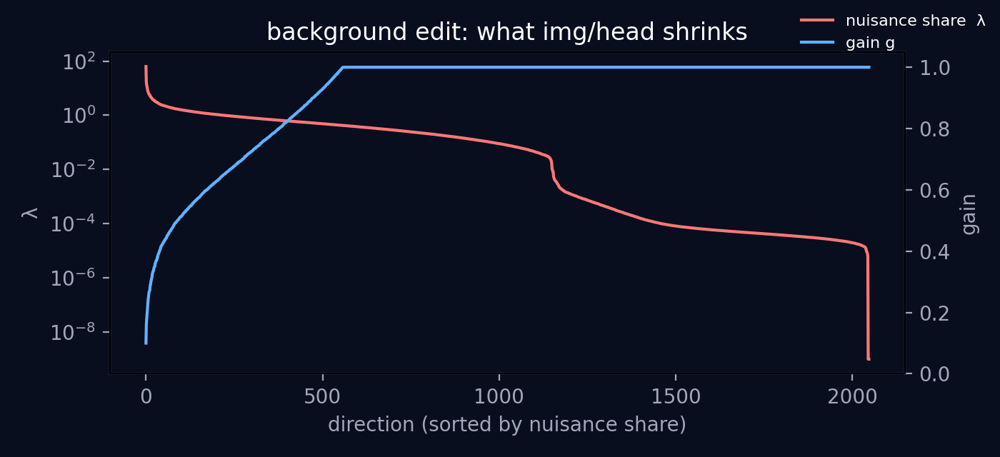
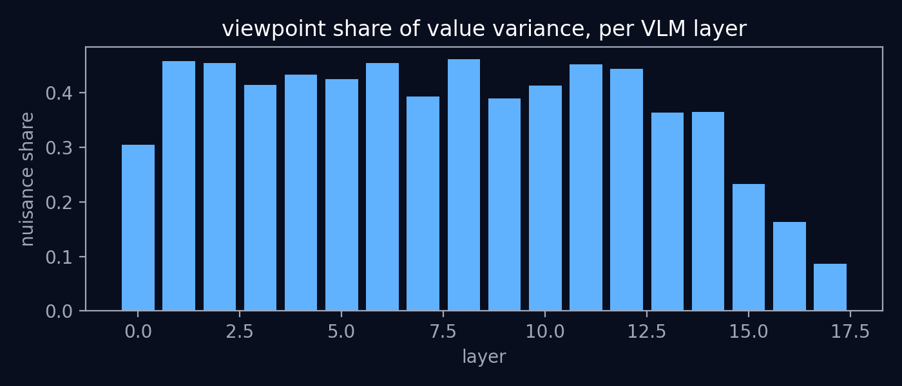

# pi0.5 weight surgery

**Make a robot policy robust to visual distractors by editing its weights directly: no gradients, no fine-tuning,
same model size, zero extra compute.**

pi0.5 (fine-tuned on LIBERO) is easily fooled when the background changes or the camera moves. We fix that with two
closed-form edits written *exactly* into tensors the model already has.

| pi0.5 on LIBERO, held-out episodes, all 4 suites (120 per cell) | Original | **Edited** |
|---|---|---|
| Clean | 97% | **98%** |
| Background replaced by a random photo | 58% | **73%** |
| Third-person camera orbited 90 deg | 41% | **54%** |

<p align="center"></p>

## The recipe

1. **Render each moment twice.** In simulation, take a state from a normal rollout and render it again with *only* the
   nuisance changed: the background swapped for a photo, or the camera moved. Everything that differs between the two
   inside the model is nuisance.
2. **Measure what the nuisance moves.** Feed both through pi0.5 and compare features at matching positions: the same
   image patch for backgrounds; for camera moves, the patch that sees the same 3D point (from simulator depth).
3. **Shrink it in closed form.** A Fisher discriminant (two covariance matrices, one generalized eigendecomposition)
   finds directions whose variance comes mostly from the nuisance and turns them down. Shrink only, never amplify.
4. **Write it into the right weights.** Pick the place from *how* the policy fails:
   - appearance (backgrounds): the vision->language projection `img/head`: `W' = W + W B^T`, `b' = b + (b - mu) B^T`;
   - geometry (camera pose: the robot still grasps but misplaces): the attention **values** of VLM layers 9-17, which
     the action expert reads: `W_v' = W_v + W_v B^T`. Fit in order, after the background edit.
5. **Select honestly.** Fit on practice episodes, choose settings on separate episodes with a rule written down first,
   test once on held-out episodes.

Both edits are exact linear maps folded into existing matrices, so the edited model *is* a pi0.5 checkpoint.

## Two ways to use this repo

**A. The recipe as an API** (`wsp_vla/`), see `examples/recipe_pi05_libero.py`:

```python
from wsp_vla.model import Pi05, fit_img_head_edit, fit_value_edit      # openpi env
pi = Pi05()
bg = fit_img_head_edit(pi, ["pairs/bg_libero_object.npz"], beta=1.0)
cam = fit_value_edit(pi, camera_pair_files, pre_edits=[bg], beta=2.0, layers=range(9, 18))
```

```bash
python -m wsp_vla.server --port 8001                                   # openpi env: per-request edits, no recompile
python scripts/collect_pairs.py --suite libero_object --episodes 13-17 --kind camera --out pairs/cam_object.npz   # LIBERO env
python scripts/fit.py camera --pairs pairs/cam_*.npz --pre edits/bg.json --beta 2 --layers 9-17 --out edits/cam.npz
python scripts/evaluate.py --suite libero_goal --episodes 0-1 --condition orbit90 --edits edits/cam.json --tag final
python -m wsp_vla.export --edits edits/cam.json --out edits/pi05_libero_edited.npz      # ~85 MB: only changed tensors
```

**B. The agentic approach** (`agent/AGENT.md`, `.claude/skills/vla-weight-surgery/`): the protocol an AI agent follows to
find edits like these itself: measure what fools the policy, watch failure videos, choose the edit location, collect
pairs, fit, select with a pre-registered rule, test once. It includes what worked and what did not on pi0.5. With Claude
Code: open this repo and ask "harden pi0.5 against <nuisance>"; the skill loads the protocol.

## Visualizations (`wsp_vla/viz`, `scripts/plot.py`, `scripts/make_demo_video.py`)
- side-by-side comparison videos from a JSON manifest (title, example spotlights, random-episode grids, results card);
- results bars, Fisher spectra (what the edit shrinks), per-layer nuisance share.
Default theme is navy/blue; fonts via `WSP_FONT=path[:index]`.

<p align="center"></p>
<p align="center"> </p>

Left: the background edit shrinks ~550 of 2048 token directions (the most nuisance-dominated to 0.1x) and leaves the
rest untouched. Right: share of attention-value variance caused by camera pose, per VLM layer. Full video: `assets/demo.mp4`.

## Setup
Two environments, as in openpi: the model side runs in the openpi env (JAX, Python 3.11) and the simulator side in the
LIBERO env (Python 3.8). Add this repo to `PYTHONPATH` in both. Checkpoint: `gs://openpi-assets/checkpoints/pi05_libero`.
Background photos: set `WSP_ADE_DIR` (ADE20K training images, used to FIT the background edit) and `WSP_COCO_DIR`
(COCO val2017, used to TEST it) -- different datasets on purpose. `examples/demo_manifest_example.json` shows the video
manifest format (paths are placeholders).

## Caveats
Simulation only. The background swap is image-level (simulator segmentation + photo), not a physical scene change.
Camera gains are largest on LIBERO-Object and small on the other suites; editing early layers buys more camera
robustness but slows long-horizon tasks. Instruction following (asking for a different object than the trained one)
is not fixed. Episode counts are smaller than the standard 500 per suite.
